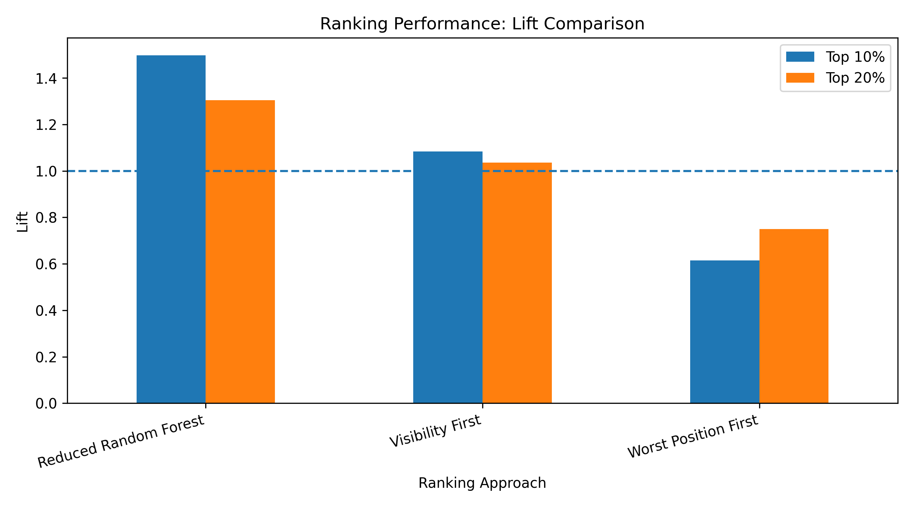
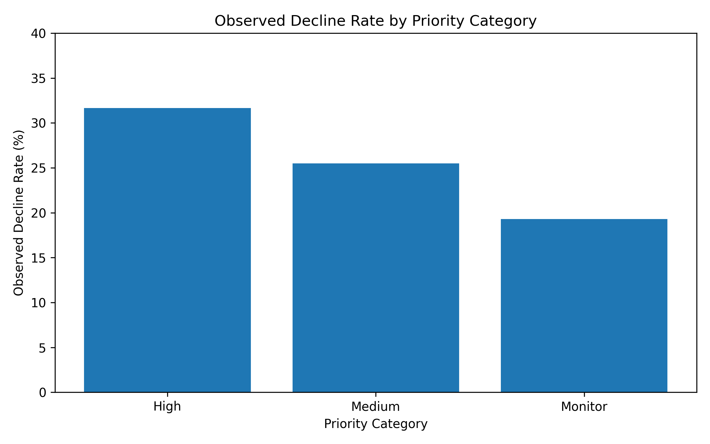
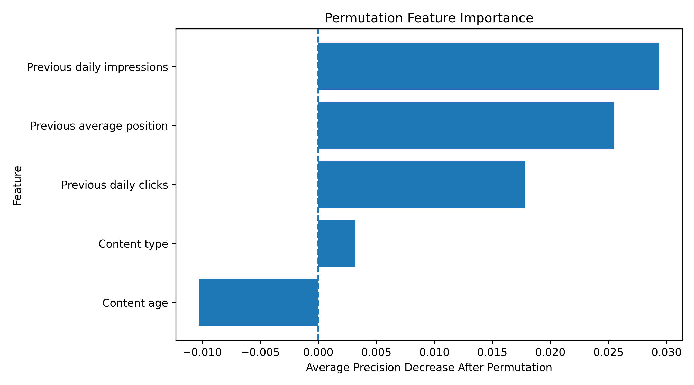

# Prioritizing Content for Review

## A Client-Grouped Machine Learning Approach to Predicting Search Impression Declines

## Abstract

This study investigates whether historical Google Search Console (GSC) performance can help identify website content that may experience a decline in search impressions. Using the FlyRank ML Internship dataset, we developed a Random Forest model based on historical impressions, clicks, and average search position. The model was evaluated using five-fold GroupKFold cross-validation, keeping clients separated between training and validation folds. The reduced model achieved a pooled out-of-fold PR-AUC of 0.275 and a top-10% ranking lift of approximately 1.50 compared with the overall decline rate. The findings suggest that historical search performance can help prioritize content for human review, although the model does not establish that refreshing content will improve its performance.

## 1. Introduction and Problem Statement

Websites often contain large numbers of pages, making it difficult to decide which content should be reviewed or updated first. A practical content strategy needs a way to prioritize pages using available performance data.

This project explores whether machine learning can help identify content that is at risk of experiencing a decline in search impressions. Instead of attempting to predict the exact future performance of every page, the objective is to create a ranked review queue that helps prioritize limited content-management resources.

The research question is:

**Can historical search performance data help rank content pages according to their likelihood of experiencing a meaningful decline in search impressions?**

The intended use is decision support. The model identifies pages that deserve attention; it does not automatically decide that a page must be refreshed.

## 2. Data

### Dataset source

The analysis uses the `FlyRank/internship-warehouse` dataset, accessed through DuckDB.

The analysis combines information from:
- `fact_content_daily_performance`
- `dim_content`

The dataset was accessed as part of the FlyRank ML Internship. A separate dataset release identifier was not available in the supplied materials.

### Observation unit

Each observation represents a client-content page pair with historical search performance and a subsequent outcome period.

The final eligible dataset contains **64,858 observations across 25 clients**.

### Time windows

Two consecutive 30-day periods were used:

- Previous performance period: January 30–February 28, 2026.
- Outcome period: March 1–March 30, 2026.

### Eligibility and exclusions

An observation was included when:
- GSC data was available for at least 25 days in each period.
- Previous-period impressions were greater than zero.
- The content metadata could be matched to the performance record.

Google Analytics 4 (GA4) features were excluded because of substantial missingness, approximately 73%.

Content update dates and word counts were excluded because the available metadata snapshot could not establish whether those values were known at the prediction date.

Client and content identifiers were used for joining and grouping, not as predictive features.

## 3. Methodology

### Target definition

The target variable, `is_declining`, identifies whether average daily impressions decreased by at least 20% in the outcome period compared with the previous period.

A value of 1 indicates a decline, while 0 indicates no decline meeting this threshold.

The resulting dataset contains:
- Declining observations: 13,709 (21.14%).
- Non-declining observations: 51,149 (78.86%).

### Predictive features

The final reduced model uses three historical GSC features:

1. Previous average daily impressions.
2. Previous average daily clicks.
3. Previous average search position.

These features were selected because they describe search performance during the previous period rather than the future outcome.

The initial five-feature model also included content type and content age. The reduced model was selected after comparing cross-validation results.

### Model

A Random Forest classifier was used with the following settings:

- Number of trees: 300.
- Minimum samples per leaf: 10.
- Class weighting: balanced.
- Random state: 42.
- Missing numerical values: median imputation.

### Validation design

The model was evaluated using five-fold GroupKFold cross-validation, grouping observations by client.

This approach prevents observations from the same client from appearing in both the training and validation sets within a fold.

The folds were uneven in size because the number of observations differed substantially between clients. In particular, some folds were dominated by a single client.

### Baseline comparisons

The model's ranking performance was compared with two simple ranking strategies using the same validation folds:

- Visibility-first: rank pages by previous daily impressions, highest first.
- Worst-position-first: rank pages by previous average search position, worst first.

### Leakage checks

Features that could reveal or directly encode the outcome were excluded. In particular, `trend_direction` and `trend_pct` were not used as predictive features because they could contain information related to the target.

The model uses historical performance features only. However, feature selection was informed by the same cross-validation results used for evaluation, so the reported performance may be optimistic.

## 4. Results

### Overall model performance

The reduced Random Forest model achieved:

| Metric | Result |
|---|---:|
| Pooled out-of-fold PR-AUC | 0.275 |
| Pooled out-of-fold ROC-AUC | 0.597 |
| Average fold PR-AUC | 0.266 |
| Average fold ROC-AUC | 0.592 |

The original five-feature model achieved a pooled PR-AUC of 0.256 and ROC-AUC of 0.575.

The reduced model performed better on these metrics, although this comparison should be interpreted cautiously because feature selection used the same cross-validation results.

### Ranking performance

The main practical objective is to identify a smaller group of pages containing a higher proportion of future declines.

| Ranking strategy | Top 10% lift | Top 20% lift |
|---|---:|---:|
| Reduced Random Forest | 1.498 | 1.305 |
| Visibility-first | 1.084 | 1.035 |
| Worst-position-first | 0.614 | 0.750 |

The Random Forest model achieved a top-10% precision of approximately 31.7%, compared with an overall decline rate of 21.14%.

This means the highest-scored 10% of observations contained approximately 1.50 times the overall concentration of declining observations.

### Priority categories

The ranked observations were divided into three priority categories.

| Category | Observations | Observed decline rate |
|---|---:|---:|
| High | 6,485 | 31.6% |
| Medium | 6,486 | 25.5% |
| Monitor | 51,887 | 19.3% |

The High category had the greatest observed decline rate, approximately 1.50 times the overall rate.

### Feature importance

Permutation feature importance was used to examine how much each feature contributed to model performance.

The importance results help describe the model's reliance on historical search-performance information. They should not be interpreted as evidence that a feature causes future declines.

## 5. Limitations and Honest Interpretation

Several limitations affect how these findings should be interpreted.

1. **Limited client coverage:** The analysis contains 25 clients. Results may not generalize to other clients or websites.

2. **Uneven validation folds:** Client group sizes differ substantially, and some folds are dominated by one client.

3. **Feature-selection bias:** The reduced feature set was selected using the same cross-validation results used for evaluation. An independent holdout evaluation is needed for a stronger estimate of generalization performance.

4. **Historical cohort:** The analysis uses January and March 2026 data. It does not identify pages that are currently declining.

5. **Target definition:** A 20% decrease in average daily impressions is an operational definition of decline, not proof that a page has become low quality.

6. **Missing data:** GA4 variables were excluded because of substantial missingness.

7. **No causal conclusion:** The model predicts an association with subsequent impression declines. It does not prove that refreshing a page will improve its search performance.

8. **Baseline limitations:** The comparison uses two simple ranking strategies. A separate stale-content baseline was not evaluated because the available update-date information could not be reliably established as known at the prediction date.

For these reasons, the model should be treated as a prioritization aid rather than an automated content-refresh decision system.

## 6. Ranked Recommendations and Action Playbook

The model can support a practical content-review workflow.

### High priority

Pages in the High category should be reviewed first.

Suggested actions:
- Inspect recent search impressions and clicks.
- Review the page's search intent and relevance.
- Check whether important information is outdated.
- Investigate technical indexing or visibility problems.
- Decide whether an update is justified after human review.

### Medium priority

Pages in the Medium category should be monitored and reviewed when resources allow.

Suggested actions:
- Monitor changes in impressions and clicks.
- Check whether search performance is consistently declining.
- Review content quality and relevance when there are additional warning signs.

### Monitor

Pages in the Monitor category can remain under regular performance monitoring.

Suggested actions:
- Continue tracking search performance.
- Reassess priority when new data becomes available.
- Avoid unnecessary updates based only on the model score.

### Important note about zero-click observations

Zero-click observations can be used as an additional review signal, but zero clicks alone do not prove that a page needs refreshing.

All recommendations require human inspection before action.

## 7. Reproducibility and Project Artifacts

The project repository contains the analysis notebooks, supporting materials, and output files.

**GitHub repository:**  
[The-ML-internsip](https://github.com/yousseftarektalkhan2006-blip/The-ML-internsip)

The analysis notebook and supporting outputs are stored in the repository's `work` directory.

The charts displayed in this paper are stored in `docs/assets`.

The ranked recommendation output is retained as a project artifact and is not published as a public page-level recommendation list.

## 8. Conclusion

This project demonstrates how historical search-performance data can be used to rank content according to its likelihood of experiencing a subsequent decline in impressions.

The reduced Random Forest model outperformed the two simple ranking baselines in the evaluated top-10% and top-20% ranking comparisons.

The results indicate that machine learning can help organize content-review priorities, but the model's limitations make human review essential.

Future work should include an independent holdout evaluation, additional client coverage, and testing on newer time periods.

## Acknowledgments and Data Credit

Built on the [FlyRank ML Internship dataset](https://flyrank.ai).

This research was completed as part of the FlyRank ML Internship.
